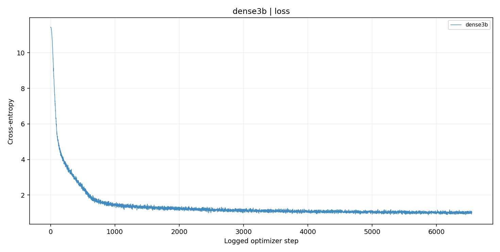
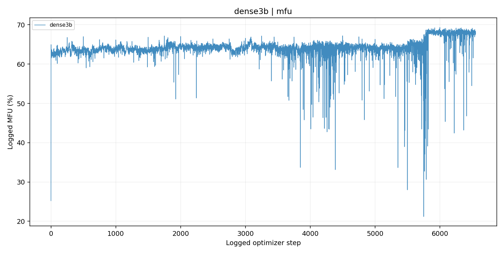
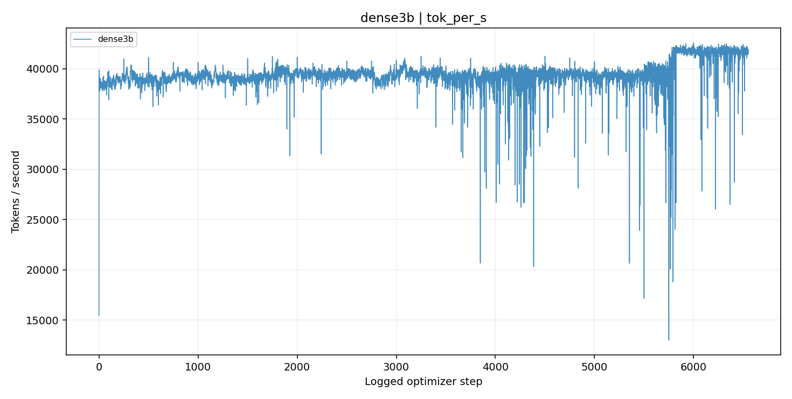

# dense3b

Dense 3B-class code pretraining: deployed implementation, data pipeline, checkpoint results and auditable training curves.

**[All checkpoints and results](reports/RESULTS.md) · [MFU, loss, throughput and every system metric](reports/SYSTEMS.md) · [Backfill progress](reports/CAMPAIGN.md)**

Training/evaluation capture started **2026-10-09T23:55:40.432744+00:00 / 2026-10-09T23:55:40.429869+00:00**. Jobs continued while files were copied; these are timestamped snapshots, not a live dashboard.

## Training and efficiency

| Variant | Latest logged step | Latest loss | MFU median, last ≤100 | Global tok/s median, last ≤100 | Peak allocated GB, latest |
|---|---:|---:|---:|---:|---:|
| dense3b | 6615 | 1.0351 | 68.09% | 41,780 | 22.387 |

MFU is the logged model-FLOP estimate, not device utilization. Per-step throughput excludes unrecorded downtime. The systems page includes every numeric logged field, full unsmoothed data, per-run provenance and the explicit resume-display policy.







## Latest completed task results in the new scoring campaign

Latest checkpoint per variant/task/metric, not the highest score. The table may combine tasks at different steps, which are shown explicitly. Historical results and all protocols remain in the complete result index.

| Variant | Step | Task / metric | Score | n | Verified count |
|---|---:|---|---:|---:|---|
| dense3b | [6499](reports/checkpoints/dense3b-step_00006499.md) | arc_challenge / acc | 28.6689% | 1172 | 336/1172 |
| dense3b | [6499](reports/checkpoints/dense3b-step_00006499.md) | arc_challenge / acc_norm | 31.0580% | 1172 | 364/1172 |
| dense3b | [6499](reports/checkpoints/dense3b-step_00006499.md) | arc_easy / acc | 61.9949% | 2376 | 1473/2376 |
| dense3b | [6499](reports/checkpoints/dense3b-step_00006499.md) | arc_easy / acc_norm | 53.4933% | 2376 | 1271/2376 |
| dense3b | [6499](reports/checkpoints/dense3b-step_00006499.md) | boolq / acc | 58.6544% | 3270 | 1918/3270 |
| dense3b | [6499](reports/checkpoints/dense3b-step_00006499.md) | boolq / acc_norm | 62.2324% | 3270 | 2035/3270 |
| dense3b | [6499](reports/checkpoints/dense3b-step_00006499.md) | cruxeval / cruxeval_i | 13.3800% | 800 | 107/800 |
| dense3b | [6499](reports/checkpoints/dense3b-step_00006499.md) | cruxeval / cruxeval_o | 20.2500% | 800 | 162/800 |
| dense3b | [6499](reports/checkpoints/dense3b-step_00006499.md) | gsm8k / gsm8k | 11.5239% | 1319 | 152/1319 |
| dense3b | [6499](reports/checkpoints/dense3b-step_00006499.md) | gsm8k / strict_accuracy | 11.3723% | 1319 | 150/1319 |
| dense3b | [6499](reports/checkpoints/dense3b-step_00006499.md) | hellaswag / acc | 31.1691% | 10042 | 3130/10042 |
| dense3b | [6499](reports/checkpoints/dense3b-step_00006499.md) | hellaswag / acc_norm | 35.7499% | 10042 | 3590/10042 |
| dense3b | [6499](reports/checkpoints/dense3b-step_00006499.md) | humaneval / humaneval | 25.6098% | 164 | 42/164 |
| dense3b | [6499](reports/checkpoints/dense3b-step_00006499.md) | humaneval / humaneval_plus | 25.0000% | 164 | 41/164 |
| dense3b | [6499](reports/checkpoints/dense3b-step_00006499.md) | mbpp / mbpp | 33.3333% | 378 | 126/378 |
| dense3b | [6499](reports/checkpoints/dense3b-step_00006499.md) | mbpp / mbpp_plus | 26.9841% | 378 | 102/378 |
| dense3b | [6499](reports/checkpoints/dense3b-step_00006499.md) | mmlu_cf / acc | 28.5714% | 14042 | 4012/14042 |
| dense3b | [6499](reports/checkpoints/dense3b-step_00006499.md) | mmlu_cf / acc_norm | 29.8462% | 14042 | 4191/14042 |
| dense3b | [6499](reports/checkpoints/dense3b-step_00006499.md) | mmlu_mc5 / acc | 25.2314% | 14042 | 3543/14042 |
| dense3b | [6499](reports/checkpoints/dense3b-step_00006499.md) | mmlu_mc5 / acc_norm | 25.2314% | 14042 | 3543/14042 |
| dense3b | [6499](reports/checkpoints/dense3b-step_00006499.md) | openbookqa / acc | 22.0000% | 500 | 110/500 |
| dense3b | [6499](reports/checkpoints/dense3b-step_00006499.md) | openbookqa / acc_norm | 32.6000% | 500 | 163/500 |
| dense3b | [6499](reports/checkpoints/dense3b-step_00006499.md) | sciq / acc | 84.3000% | 1000 | 843/1000 |
| dense3b | [6499](reports/checkpoints/dense3b-step_00006499.md) | sciq / acc_norm | 79.6000% | 1000 | 796/1000 |
| dense3b | [6499](reports/checkpoints/dense3b-step_00006499.md) | winogrande / acc | 51.9337% | 1267 | 658/1267 |
| dense3b | [6499](reports/checkpoints/dense3b-step_00006499.md) | winogrande / acc_norm | 51.9337% | 1267 | 658/1267 |

## Archived architecture and accounting

| Variant | Total parameters | Active parameters |
|---|---:|---:|
| dense3b | 3,237,529,600 | 3,237,529,600 |

These are archived configuration counts, including embeddings; they are not task-quality rankings.

## Reproduction and provenance

```bash
python -m pip install -r requirements-report.txt
python scripts/verify_publication.py
python scripts/build_all_results.py --root .
python -m unittest discover -s tests/publication -v
```

[Current immutable capture manifest](provenance/sync-20261009T2354Z/manifest.json) · [Latest capture pointer](provenance/sync_latest.json) · [Original snapshot inventory](provenance/snapshot.json) · [Earlier checkpoint audit](reports/checkpoint_audit/CHECKPOINTS.md)

Original logs/results and deployed source snapshots are preserved by hash. No original training source was overwritten by this synchronization. Tensor weights, optimizer states, data shards, credentials and installed binary caches are not Git payloads. Live file/pin inventories include exact paths, sizes and capture times. Loss values keep cross-entropy units; unmeasured values stay absent.

New Plus results use the documented corrected EvalPlus backend; historical custom Plus scores are not silently merged into the same protocol. MC accuracy and byte-normalized accuracy remain separate. GSM8K strict phrase extraction and relaxed answer extraction are separate metrics. A sample-flag recount verifies arithmetic, not all assumptions of the original execution harness.

[Build verification](reports/sync_verification.json) · [Input/capture issues](reports/sync_issues.json) · [All figures](reports/figures/all/index.json)

## Public-history network redaction

Historical runtime network addresses were redacted from the public Git history. Original and public artifact hashes are distinguished in [publication security notes](docs/PUBLICATION_SECURITY.md). No model training or evaluation was rerun.
