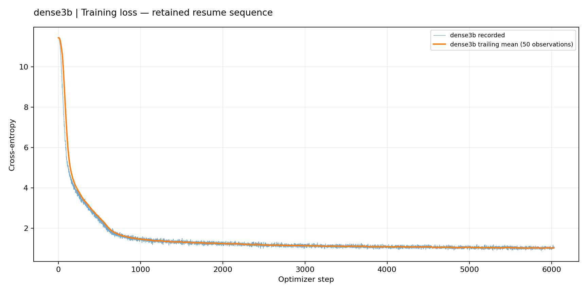
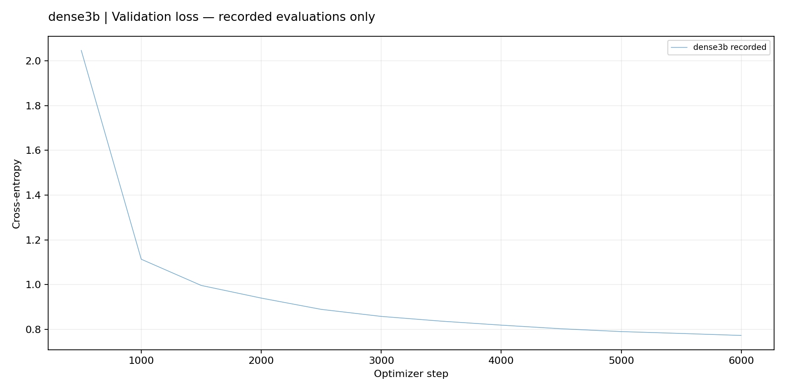
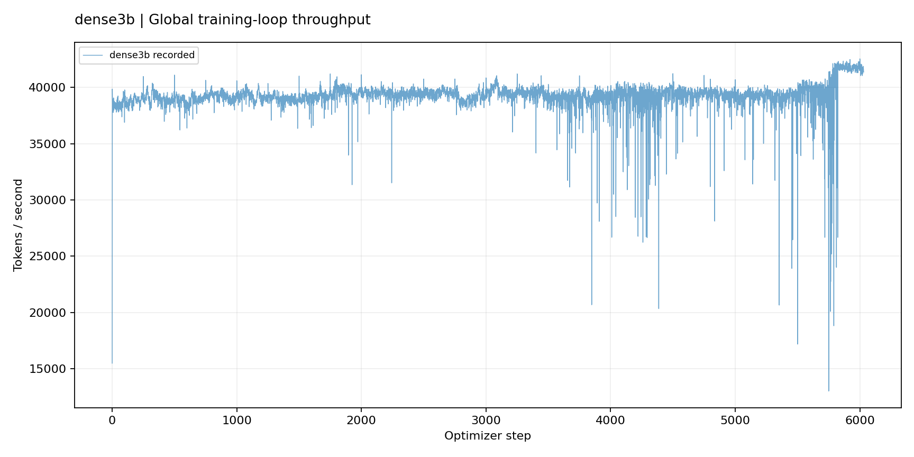
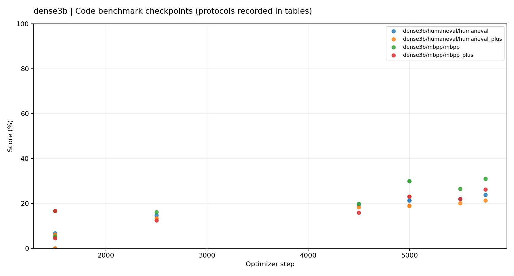

# dense3b

Dense 3B-class code pretraining: deployed implementation, data pipeline, checkpoint results and auditable training curves.

**Evidence snapshot (UTC): 2026-10-09T18:34:41Z.** This is an archived measurement, not a live status feed.

## Experiment coverage

| Variant | Latest retained step | Retained observations | Mean loss, last ≤100 | Median global tok/s, last ≤100 |
|---|---:|---:|---:|---:|
| dense3b | 6031 | 6032 | 1.0275 | 41,789 |

### Archived architecture presets

| Variant | Total parameters | Active parameters |
|---|---:|---:|
| dense3b | 3,237,529,600 | 3,237,529,600 |

Counts are computed by the archived `model/config.py` accounting function, including embeddings. They are configuration counts, not measurements of task quality.

### Archived architecture presets

| Variant | Total parameters | Active parameters |
|---|---:|---:|
| dense3b | 3,237,529,600 | 3,237,529,600 |

Counts are computed by the archived `model/config.py` accounting function, including embeddings. They are configuration counts, not measurements of task quality.

A missing series means no completed training metric record was found in this snapshot; it is not a zero result. Full failed-run logs and all configured research variants are preserved. Throughput is the training-loop measurement, not end-to-end wall-clock throughput.

## Learning curves









[All figures](reports/figures/) · [All production runs including rollbacks](reports/figures/loss_all_runs.png) · [Raw training CSV](reports/training_all.csv) · [Run index](reports/run_index.json)

## Latest observed evaluation metrics

Selection is by checkpoint step, then archived archived source timestamp—not by the highest score. Different protocols, sample counts, tokenizers and custom MMLU variants are not treated as directly comparable. Benchmark figures use points rather than connecting different evaluations.

| Variant | Task / metric | Step | Score | n | Verified tokens (B) | Evidence |
|---|---|---:|---:|---:|---:|---|
| dense3b | arc_challenge / acc | 5749 | 26.71% | 1172 | — | [JSON](evidence/raw/results/mc-step_00005749.json) |
| dense3b | arc_challenge / acc_norm | 5749 | 30.63% | 1172 | — | [JSON](evidence/raw/results/mc-step_00005749.json) |
| dense3b | arc_easy / acc | 5749 | 63.05% | 2376 | — | [JSON](evidence/raw/results/mc-step_00005749.json) |
| dense3b | arc_easy / acc_norm | 5749 | 56.94% | 2376 | — | [JSON](evidence/raw/results/mc-step_00005749.json) |
| dense3b | boolq / acc | 5749 | 57.80% | 3270 | — | [JSON](evidence/raw/results/mc-step_00005749.json) |
| dense3b | boolq / acc_norm | 5749 | 61.96% | 3270 | — | [JSON](evidence/raw/results/mc-step_00005749.json) |
| dense3b | cruxeval / cruxeval_i | 5749 | 17.25% | 800 | — | [JSON](evidence/raw/results/suite-step_00005749.json) |
| dense3b | cruxeval / cruxeval_o | 5749 | 19.50% | 800 | — | [JSON](evidence/raw/results/suite-step_00005749.json) |
| dense3b | gsm8k / gsm8k | 5749 | 9.63% | 1319 | — | [JSON](evidence/raw/results/suite-step_00005749.json) |
| dense3b | heldout / swallow-code | 4999 | 56.06% | — | — | [JSON](evidence/imported/moe1b/suite-step_00004999-1673758.json) |
| dense3b | hellaswag / acc | 5749 | 30.52% | 10042 | — | [JSON](evidence/raw/results/mc-step_00005749.json) |
| dense3b | hellaswag / acc_norm | 5749 | 34.77% | 10042 | — | [JSON](evidence/raw/results/mc-step_00005749.json) |
| dense3b | humaneval / humaneval | 5749 | 23.78% | 164 | — | [JSON](evidence/raw/results/suite-step_00005749.json) |
| dense3b | humaneval / humaneval_plus | 5749 | 21.34% | 164 | — | [JSON](evidence/raw/results/suite-step_00005749.json) |
| dense3b | lcb / lcb_added_in_v1 | 4999 | 0.25% | {'added_in_v1': 400, 'added_in_v2': 111, 'added_in_v3': 101, 'added_in_v4': 101, 'added_in_v5': 167, 'added_in_v6': 175, 'release_v6_cumulative': 1055} | — | [JSON](evidence/imported/moe1b/suite-step_00004999-1673758.json) |
| dense3b | lcb / lcb_added_in_v2 | 4999 | 0.00% | {'added_in_v1': 400, 'added_in_v2': 111, 'added_in_v3': 101, 'added_in_v4': 101, 'added_in_v5': 167, 'added_in_v6': 175, 'release_v6_cumulative': 1055} | — | [JSON](evidence/imported/moe1b/suite-step_00004999-1673758.json) |
| dense3b | lcb / lcb_added_in_v3 | 4999 | 0.99% | {'added_in_v1': 400, 'added_in_v2': 111, 'added_in_v3': 101, 'added_in_v4': 101, 'added_in_v5': 167, 'added_in_v6': 175, 'release_v6_cumulative': 1055} | — | [JSON](evidence/imported/moe1b/suite-step_00004999-1673758.json) |
| dense3b | lcb / lcb_added_in_v4 | 4999 | 0.00% | {'added_in_v1': 400, 'added_in_v2': 111, 'added_in_v3': 101, 'added_in_v4': 101, 'added_in_v5': 167, 'added_in_v6': 175, 'release_v6_cumulative': 1055} | — | [JSON](evidence/imported/moe1b/suite-step_00004999-1673758.json) |
| dense3b | lcb / lcb_added_in_v5 | 4999 | 0.60% | {'added_in_v1': 400, 'added_in_v2': 111, 'added_in_v3': 101, 'added_in_v4': 101, 'added_in_v5': 167, 'added_in_v6': 175, 'release_v6_cumulative': 1055} | — | [JSON](evidence/imported/moe1b/suite-step_00004999-1673758.json) |
| dense3b | lcb / lcb_added_in_v6 | 4999 | 0.00% | {'added_in_v1': 400, 'added_in_v2': 111, 'added_in_v3': 101, 'added_in_v4': 101, 'added_in_v5': 167, 'added_in_v6': 175, 'release_v6_cumulative': 1055} | — | [JSON](evidence/imported/moe1b/suite-step_00004999-1673758.json) |
| dense3b | lcb / lcb_release_v6_cumulative | 4999 | 0.28% | {'added_in_v1': 400, 'added_in_v2': 111, 'added_in_v3': 101, 'added_in_v4': 101, 'added_in_v5': 167, 'added_in_v6': 175, 'release_v6_cumulative': 1055} | — | [JSON](evidence/imported/moe1b/suite-step_00004999-1673758.json) |
| dense3b | lcb / lcb_v6_slice_175_post_cutoff | 4999 | 0.00% | {'added_in_v1': 400, 'added_in_v2': 111, 'added_in_v3': 101, 'added_in_v4': 101, 'added_in_v5': 167, 'added_in_v6': 175, 'release_v6_cumulative': 1055} | — | [JSON](evidence/imported/moe1b/suite-step_00004999-1673758.json) |
| dense3b | mbpp / mbpp | 5749 | 30.95% | 378 | — | [JSON](evidence/raw/results/suite-step_00005749.json) |
| dense3b | mbpp / mbpp_plus | 5749 | 26.19% | 378 | — | [JSON](evidence/raw/results/suite-step_00005749.json) |
| dense3b | mmlu_cf / acc | 5749 | 28.29% | 14042 | — | [JSON](evidence/raw/results/mc-step_00005749.json) |
| dense3b | mmlu_cf / acc_norm | 5749 | 29.45% | 14042 | — | [JSON](evidence/raw/results/mc-step_00005749.json) |
| dense3b | mmlu_mc5 / acc | 5499 | 25.18% | 14042 | — | [JSON](evidence/imported/moe1b/mc-dense3b-step5499.json) |
| dense3b | mmlu_mc5 / acc_norm | 5499 | 25.18% | 14042 | — | [JSON](evidence/imported/moe1b/mc-dense3b-step5499.json) |
| dense3b | openbookqa / acc | 5749 | 21.40% | 500 | — | [JSON](evidence/raw/results/mc-step_00005749.json) |
| dense3b | openbookqa / acc_norm | 5749 | 34.40% | 500 | — | [JSON](evidence/raw/results/mc-step_00005749.json) |
| dense3b | sciq / acc | 5749 | 85.80% | 1000 | — | [JSON](evidence/raw/results/mc-step_00005749.json) |
| dense3b | sciq / acc_norm | 5749 | 80.60% | 1000 | — | [JSON](evidence/raw/results/mc-step_00005749.json) |
| dense3b | winogrande / acc | 5749 | 51.22% | 1267 | — | [JSON](evidence/raw/results/mc-step_00005749.json) |
| dense3b | winogrande / acc_norm | 5749 | 51.22% | 1267 | — | [JSON](evidence/raw/results/mc-step_00005749.json) |

### Evidence cautions

The audit found **0 evaluation summaries with token counts inconsistent with retained checkpoint metadata**. Original JSON files are unchanged. Verified counts use `samples_consumed × args.seq_len`; unsupported counts stay blank. Step is used on plot axes rather than substituting an assumed sequence length.

[Complete chronological metrics](reports/evaluation_history.csv) · [Checkpoint registry](reports/checkpoint_registry.json) · [Audit findings](reports/data_audit.json)

## Code and reproduction

`model/` contains architecture and kernels; `train/` contains optimizers, data loading, checkpointing and distributed training; `bench/` and `tests/` retain evaluation, profiling and correctness code. `operations/` retains the deployed cluster helpers. Data preparation and tokenizer files, when available, are under `data_pipeline/`, `code3b/` and `tokenizer/`. Original cluster paths remain in deployed scripts so the archived implementation is not silently rewritten. Adapt those paths explicitly for another machine.

```bash
python3 -m venv .venv-report
source .venv-report/bin/activate
python -m pip install -r requirements-report.txt
python scripts/verify_publication.py
python -m unittest discover -s tests/publication -v
python scripts/build_dashboard.py --root .
```

Report generation uses archived local files only and does not submit jobs or access GPUs. Publication checks do not constitute a rerun of CUDA training or model benchmarks.

## Provenance and scope

[Snapshot and file hashes](provenance/snapshot.json) · [Imported result routing](provenance/imported-results.json) · [Extraction methodology](reports/METHODOLOGY.md)

Source, configurations, original metrics, evaluator manifests, sample-level outputs and checkpoint metadata are versioned. Model weights, optimizer tensors, token shards, datasets, credentials, caches and installed binary dependencies are intentionally not Git payloads. Historical code versions remain in Git commits. Training losses across different data recipes/tokenizers are not a ranking of model quality.
