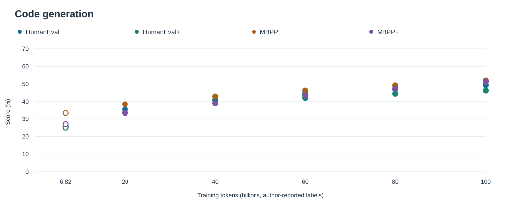
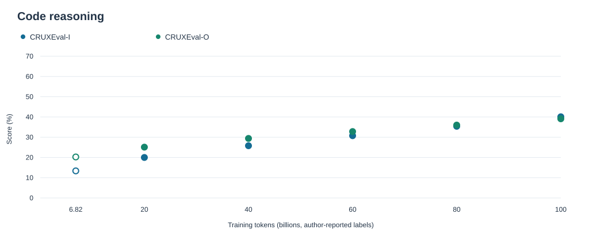
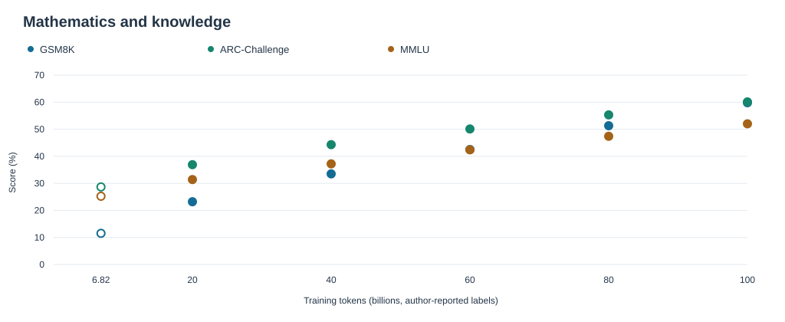

# Dense3B — measured results through 100B tokens

[Repository overview](../README.md) · [Project page](https://yinli-systems.github.io/dense3b/) · [CSV](measured/results.csv) · [JSON](../results/measured/2026-10-18.json) · [Historical archive](RESULTS.md)

**3,237,529,600 dense parameters · 6 milestones · 9 primary benchmarks · 54 primary scores.**

All percentages are measured results confirmed by the model author. The early row also has archived outputs; later raw outputs and evaluator manifests are not attached. [Source and protocol notes](measured/SOURCES.md).

## Complete checkpoint matrix

Units: percent. Numeric precision is retained exactly as reported.

| Benchmark | [6.82B](measured/checkpoints/6p82B.md) | [20B](measured/checkpoints/20B.md) | [40B](measured/checkpoints/40B.md) | [60B](measured/checkpoints/60B.md) | [80B](measured/checkpoints/80B.md) | [100B](measured/checkpoints/100B.md) |
|---|---:|---:|---:|---:|---:|---:|
| HumanEval | 25.61 | 35.4 | 40.9 | 44.5 | 47.0 | 49.4 |
| HumanEval+ | 25.00 | 33.5 | 39.0 | 42.1 | 44.5 | 46.3 |
| MBPP | 33.33 | 38.4 | 42.9 | 46.3 | 49.2 | 52 |
| MBPP+ | 26.98 | 33.3 | 38.9 | 43.4 | 47.4 | 51.3228 |
| CRUXEval-I | 13.38 | 20.0 | 25.8 | 30.750 | 35.4 | 40.1 |
| CRUXEval-O | 20.25 | 25.1 | 29.4 | 32.8 | 36.0 | 39.1 |
| GSM8K | 11.52 | 23.2 | 33.5 | 42.5 | 51.3 | 59.8 |
| ARC-Challenge | 28.67 | 36.9 | 44.3 | 50.1 | 55.3 | 60.1 |
| MMLU* | 25.23 | 31.4 | 37.2 | 42.4 | 47.4 | ≈52.0 |

*Early MMLU uses MC5; later MMLU protocol details are not supplied. The final value is approximate. MBPP at 100B is reported as 52% at integer precision.*

## Additional archived result

MMLU-CF at 6.82B: **28.57%**. It is distinct from MMLU-MC5. No later MMLU-CF scores are supplied.

## Capability plots

Points are observations, not fitted curves. Their presence on one plot does not independently establish matching evaluator protocols.

## Complete historical results and system metrics

[All archived checkpoint entries](RESULTS.md) · [Every archived metric/version](evaluation_history.csv) · [All training metrics](SYSTEMS.md) · [Raw training observations](training_all.csv) · [Sample recount records](sample_verification.json) · [Original snapshot homepage](../ARCHIVED_README.md).
