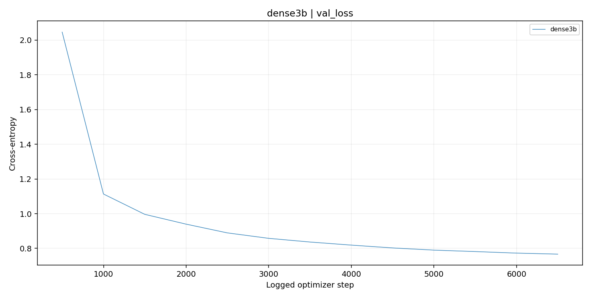
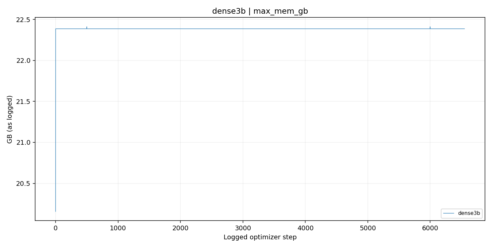
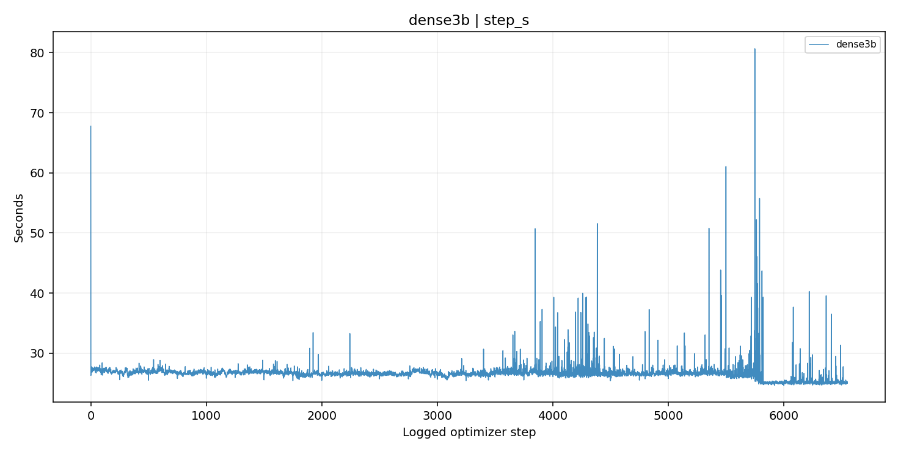

# dense3b — training and system metrics

Capture started **2026-10-09T23:20:38.782167+00:00**. Files were captured individually while jobs continued; this is not an atomic live view.

**MFU is the training implementation’s logged estimate**, not GPU device utilization. Summary medians use the last at most 100 retained observations. Throughput and step timing are training-loop measurements; queue time, all checkpoint stalls and downtime are not automatically included.

| Variant | Latest step | Meanings | MFU median | Global tok/s median | Per-GPU tok/s median | Step seconds median | Peak allocated GB, latest |
|---|---:|---|---:|---:|---:|---:|---:|
| dense3b | 6551 | Last 100 observations | 68.02% | 41,737 | 5,217 | 25.123 | 22.387 |

[All recorded observations](training_all.csv) · [Retained resume sequence](training_retained.csv) · [Run index and startup metadata](run_index.json) · [Full latest/median summary](systems_summary.csv)

## Every logged numeric metric

No metric is imputed. The all-observation table preserves diagnostic runs and replaced resume suffixes; main plots use production runs, with a later job replacing earlier observations from its first logged step. This is an explicit display policy, not proof of optimizer-state ancestry.

| Metric | Recorded observations | Variants | Chart |
|---|---:|---|---|
| `grad_norm` | 8299 | dense3b | [PNG](figures/all/training_grad_norm.png) / [SVG](figures/all/training_grad_norm.svg) |
| `loss` | 8300 | dense3b | [PNG](figures/all/training_loss.png) / [SVG](figures/all/training_loss.svg) |
| `lr` | 8325 | dense3b | [PNG](figures/all/training_lr.png) / [SVG](figures/all/training_lr.svg) |
| `max_mem_gb` | 8325 | dense3b | [PNG](figures/all/training_max_mem_gb.png) / [SVG](figures/all/training_max_mem_gb.svg) |
| `mem_fwd_bwd_gb` | 8325 | dense3b | [PNG](figures/all/training_mem_fwd_bwd_gb.png) / [SVG](figures/all/training_mem_fwd_bwd_gb.svg) |
| `mfu` | 8325 | dense3b | [PNG](figures/all/training_mfu.png) / [SVG](figures/all/training_mfu.svg) |
| `step_s` | 8325 | dense3b | [PNG](figures/all/training_step_s.png) / [SVG](figures/all/training_step_s.svg) |
| `tok_per_s` | 8325 | dense3b | [PNG](figures/all/training_tok_per_s.png) / [SVG](figures/all/training_tok_per_s.svg) |
| `tok_per_s_gpu` | 8325 | dense3b | [PNG](figures/all/training_tok_per_s_gpu.png) / [SVG](figures/all/training_tok_per_s_gpu.svg) |
| `val_antigen-fineweb-15b` | 2 | dense3b | [PNG](figures/all/training_val_antigen-fineweb-15b.png) / [SVG](figures/all/training_val_antigen-fineweb-15b.svg) |
| `val_loss` | 28 | dense3b | [PNG](figures/all/training_val_loss.png) / [SVG](figures/all/training_val_loss.svg) |
| `val_stackv2-edu` | 2 | dense3b | [PNG](figures/all/training_val_stackv2-edu.png) / [SVG](figures/all/training_val_stackv2-edu.svg) |
| `val_swallow-code` | 2 | dense3b | [PNG](figures/all/training_val_swallow-code.png) / [SVG](figures/all/training_val_swallow-code.svg) |

## loss

## val_loss

## mfu

## tok_per_s

## max_mem_gb

## step_s

